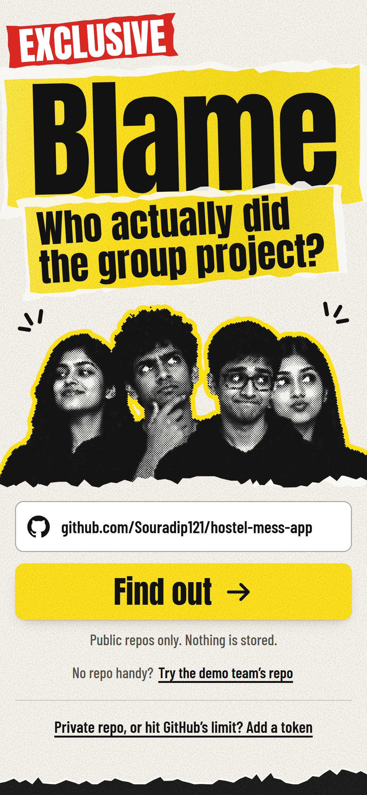
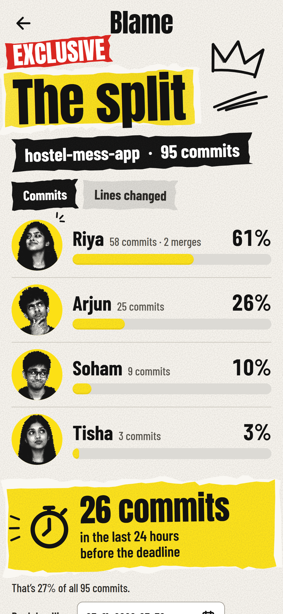
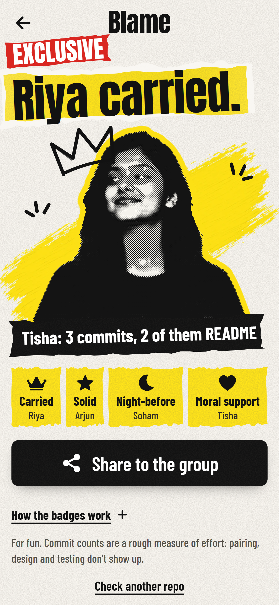

# Blame

**Don’t argue about who did the group project. Paste the repo.**

Live: **https://souradip121.github.io/blame/**

<p align="center">
  
  
  
</p>

<sub>The screenshots use [Souradip121/hostel-mess-app](https://github.com/Souradip121/hostel-mess-app), a demo repo with a made-up team and a generated history. Their portraits are AI-generated; nobody real is being blamed. The home page links it as “Try the demo team’s repo” for anyone without a repo to hand, and when it’s loaded the small print and the share card say the team is made up.</sub>

Paste a GitHub link from a group project. The page reads the repo’s history **in your browser**, straight from GitHub, and shows:

- **The split:** each person’s share of the work, counted by **commits** or by **lines changed** (switch between them).
- **The deadline crunch:** how many commits landed in the 24 hours before the final commit, or before a deadline you set.
- **The verdict:** a front-page headline (“Riya carried.”), one cheeky line about the smallest share, built only from that person’s real numbers (“Tisha: 3 commits, 2 of them README”), and a badge for everyone.
- **Share to the group:** a 1080 × 1920 front page drawn on your phone, sent through your phone’s share sheet (or saved, on a computer).

Commit counts are a rough measure of effort. Pairing, design, testing, research and whoever made the slides don’t show up in git. The verdict is for fun, and the page says so.

Made by [@souradip.sh](https://www.instagram.com/souradip.sh/) for the “I built it” series. Keyword: **BLAME**.

## How it counts

Everything below is in [`js/analyze.js`](js/analyze.js) and covered by `npm test`.

- **Only the default branch** (usually `main`) counts. Work still sitting in other branches doesn’t show up.
- **Merge commits aren’t counted.** Clicking “merge” isn’t writing the code. (GitHub’s own contributor graph leaves them out too.) Someone whose only commits are merges still shows up, with 0 commits.
- **Bots are left out:** any account GitHub marks as a bot, anything ending in `[bot]`, and names like dependabot, renovate, github-actions, imgbot, pre-commit-ci and Copilot.
- **One person, many emails.** A commit belongs to the GitHub account GitHub links its email to, so two emails linked to one login are one person. A commit from an email GitHub can’t link goes to the account that used the same author name on a linked commit. Anything left is grouped by author name (ignoring case), or by email if there’s no name. The small print says when people were merged.
- **Names** are the first word of the name people use in git (“Riya Sharma” → Riya). Two people with the same first name get an initial (“Rahul V.”, “Rahul G.”), or their GitHub login.
- **Commits** = commits that aren’t merges, by people, on the default branch.
- **Lines changed** = lines added + lines deleted. Lockfiles and folders committed by accident count too, which is why it’s the second option, not the first. Line counts come from GitHub’s contributor statistics (one request). Those only cover emails GitHub links to an account, so for anyone else the page asks GitHub for each of their commits separately: it does that by itself when it’s 45 commits or fewer and your hourly allowance has room, and otherwise asks you for a token. With a token, line counts come from GitHub’s GraphQL API, 100 commits per request, for everyone. The Lines view only appears when everyone’s lines are known; a split over part of the team would mislead.
- **Shares** are whole percentages that add up to 100 (largest remainder). A share above zero never shows as 0%: it shows as `<1%`.
- **The deadline window** is the 24 hours before the final commit, or before the deadline you set. With a deadline set, commits after it are counted and called out. Times are the commit’s author time.
- **Forks.** If the repo is a fork and anything was committed after it was forked, only those commits count (so a course starter repo’s history doesn’t make the professor carry). If nothing was, everything counts. The small print has a button to switch.
- **Big repos.** Without a token the page reads the latest 1,000 commits (10 requests); with one, the latest 3,000. A bigger repo is counted on those latest commits only, and the page says so. Lines for a big repo need a token.

## Badge rules

One badge each, checked in this order:

| Badge | Rule |
|---|---|
| **Carried** | The biggest share, if it is at least 1.5 × an even split and bigger than anyone else’s. In a solo project, the one person carried. |
| **Night-before** | 2 or more commits, and at least half of them in the 24 hours before the deadline. Only when the project ran for more than 3 days (in a hackathon, everything is the night before). |
| **Moral support** | A share under half of an even split. |
| **Solid** | Everyone else. |

An even split is 1 ÷ the number of people. With 4 people that’s 25%, so Carried needs 37.5% or more and Moral support is under 12.5%. Shares follow what you’re counting (commits or lines changed); Night-before always looks at commits.

## The headline and the cheeky line

**Headline**, first that fits: one person → “Riya did it all.” · someone Carried → “Riya carried.” · with 3+ people, the top two both above 1.25 × an even split and within 80% of each other → “Riya and Arjun carried.” · biggest share at most 1.5 × the smallest → “Shock: a fair split.” · otherwise “Riya did the most.”

**Cheeky line**, about the smallest share (ties: fewer commits, then the latest to start). First rule that fits:

1. Only merge commits: “Kabir: clicked merge 2 times, wrote 0 commits.”
2. At least half their commit messages mention the README: “Tisha: 3 commits, 2 of them README.”
3. At least half are GitHub’s upload button: “Dev: 2 commits, all of them ‘Add files via upload’.”
4. All of them (2+) in the last 24 hours: “Soham: all 7 commits in the last 24 hours.”
5. Just one commit: “Meera: 1 commit: ‘Initial commit’.”
6. At least half are one-word messages like “update”, “fix” or “final”: “Gen: 3 commits, 2 of them just ‘update’.”
7. Last commit a week or more before the end: “Q: last commit 17 days before the final one.”
8. Otherwise: “Ira: 4 commits. 6% of the work.”

## Privacy

> Nothing is stored. There is no server.

- This is static HTML, CSS and JavaScript on GitHub Pages. The page talks to `api.github.com` and loads profile pictures from `avatars.githubusercontent.com`; its Content Security Policy blocks every other destination.
- No analytics, no cookies, no trackers, no fonts or scripts from other sites.
- **Token (optional).** Without one, GitHub allows 60 requests an hour from your network; one repo takes about 5 to 15. A [fine-grained token](https://github.com/settings/personal-access-tokens/new) with read-only access raises that to 5,000 and lets the page read private repos you can see. It’s kept in `sessionStorage` (cleared when you close the tab), sent only to `api.github.com`, and “Forget the token” clears it at once.
- The share card is drawn on your phone and handed to your share sheet. It’s never uploaded anywhere by this site.

## Checked on

Real public repos, without a token unless noted (13 Nov 2026):

| Repo | Size | What it exercised |
|---|---|---|
| A 3-person student project | 22 commits | Small repo, merges, “Add files via upload” line, lines view |
| A 3-person student project | 105 commits (79 + 26 merges) | Counts match GitHub’s own per-person numbers; GitHub’s stats answered 202 at first and the page retried, then switched to Lines by itself |
| [expressjs/cors](https://github.com/expressjs/cors) | 351 commits, 61 people | dependabot left out, merges, unlinked emails grouped by name, per-commit lines for 10 commits |
| [react](https://github.com/facebook/react) | 21,791 commits | Big repo: latest 1,000 counted and said so; one person with 3 emails merged; two Sebastians told apart |
| A student fork of a course project | 21 commits | Fork: only commits since forking count (with a token, via `tools/check-repos.mjs`) |
| [Souradip121/hostel-mess-app](https://github.com/Souradip121/hostel-mess-app) | 95 commits + 2 merges | The demo: the badges, the README line, two emails from one person, a deadline |

Not tested live: an empty repo (GitHub answers 409 “Git Repository is empty.”, covered by a unit test), running out of the 60 requests (covered by a unit test), private repos with a token, and the Web Share API on a real phone (the headless browser has no share sheet, so the screenshots use the save-image fallback).

## Run your own copy

Plain files, no build step.

1. **Fork** this repo.
2. **Settings → Pages**: *Deploy from a branch*, `main`, `/ (root)`.
3. It’s live at `https://<you>.github.io/blame/` a minute later.

Locally: `python -m http.server 8000`, then open http://localhost:8000. (Opening `index.html` from disk won’t work: browsers block ES modules on `file://`.)

## Development

```bash
npm test
```

```bash
node tools/check-repos.mjs expressjs/cors facebook/react
```

- `npm test`: link parsing, people and bots, merges, forks, badges, headlines, cheeky lines, rounding, and the API client against a fake GitHub (202 retries, rate limit, 404, empty repo, bad token, paging, the token only going to api.github.com). Node 22+, no dependencies.
- `tools/check-repos.mjs`: runs the same reading and counting on real repos and prints the split. Set `GITHUB_TOKEN` (e.g. `GITHUB_TOKEN=$(gh auth token)`) to use the 5,000-an-hour limit. Writes nothing.
- `tools/make-demo-repo.mjs <folder>`: rebuilds the demo repo’s made-up history from `tools/demo-src` (seeded, so it’s the same every time).
- `tools/shoot.mjs`: retakes the reel stills (390 × 844 at 3×, so 1170 × 2532) with headless Chrome. It needs the `gh` CLI: the demo repo’s real GitHub answers are fetched with it and handed to the page, so retakes don’t use up the 60-an-hour limit.
- `tools/make-torn.mjs` regenerates `torn.css` (the torn paper edges); `tools/make-og.py` rebuilds the link preview from the stills.

| File | What it does |
|---|---|
| `index.html`, `styles.css`, `torn.css` | The three screens |
| `js/github.js` | Link parsing, the GitHub API (paging, 202 retries, rate limits, per-commit and GraphQL lines) |
| `js/analyze.js` | People, shares, the deadline window, badges, the headline and the cheeky line |
| `js/halftone.js` | Prints every face as newsprint dots on canvas |
| `js/card.js` | Draws the share card |
| `js/demo.js` | Portraits for the demo repo’s made-up team (that repo only) |
| `js/app.js` | The screens, the measure switch, the deadline, sharing |

## Licence and credits

[MIT](LICENSE).

- Fonts: Anton, Barlow and Barlow Condensed, under the SIL Open Font License, self-hosted in `assets/fonts/`.
- The four faces in `assets/suspects/` are fictional people generated with GPT Image 2.5 Flare for this project (prompts in `.impeccable/assets-src/jobs.json`), then printed as halftone by the page itself.
